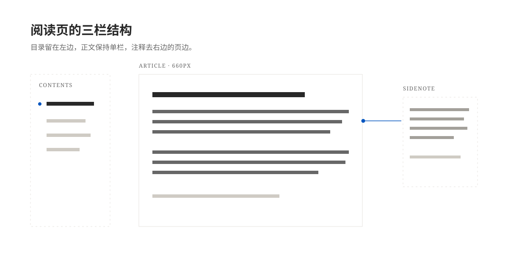

这是一篇排版测试文章。它不讨论具体技术，只把博客目前支持的 Markdown 元素依次摆出来，方便检查字号、行距、间距和颜色在真实内容里的表现。

阅读页的正文栏宽是 660px，大约每行容纳 38 个汉字[^measure]。这个宽度接近书籍的单栏排版，视线从行尾回到下一行行首时不容易串行。

## 标题与正文

正文使用 **加粗** 表示重点，用 _斜体_ 表示书名或术语，用 ~~删除线~~ 表示已经被推翻的结论。行内代码写成 `npm run build`，链接则可以直接写在句子里，例如 [Astro 的 Markdown 文档](https://docs.astro.build/en/guides/markdown-content/)。

普通段落之间留出接近一行的高度。这样即使一段很长，读者也能凭间距判断哪里是新的一段，而不需要额外的分隔线。

### 三级标题使用斜体

三级标题通常用于章节内部的小节。它比二级标题轻，但和正文仍然有明显区别。

#### 四级标题更接近正文

四级标题只在确实需要第四层结构时使用，否则容易让目录和正文都变得零碎。

## 列表

无序列表适合并列的要点：

- 每个条目只讲一件事；
- 条目之间保持相同的语法结构；
- 需要解释时，可以在条目下面再起一段。

嵌套列表也可以正常显示：

- 宽屏布局
  - 左侧目录
  - 中间正文
  - 右侧侧注
- 窄屏布局
  - 目录收进页面顶部
  - 侧注变成可展开块
  - 正文保持单栏

有序列表适合步骤：

1. 写好 Markdown 源文件；
2. 运行 `pnpm build` 检查构建；
3. 推送到 `main` 分支等待自动部署。

任务列表用来记录进度：

- [x] 完成阅读页改版
- [x] 加入侧注支持
- [ ] 给每篇文章补上真实配图
- [ ] 整理旧文章里的失效链接

## 引用与提示块

普通引用适合放一段独立的话：

> 排版的目标不是让人注意到排版，而是让读者忘记排版的存在。

提示块比引用更醒目，适合放需要注意的信息。

> [!note] 说明
> 这是一个普通的提示块。它适合补充背景信息，而不打断正文的叙述。

> [!tip] 小技巧
> 写侧注时，把注释放在引用编号附近，读者在宽屏上就能同时看到正文和解释。

> [!warning] 注意
> 侧注在窄屏下默认收起。如果注释很长，读者需要手动点击编号展开。

> [!danger] 危险操作
> 删除文章前先确认它没有被其他页面引用，尤其是首页精选和相邻文章导航。

> [!example]- 可折叠的示例
> 折叠提示块默认只显示标题，点击后才会展开内容。
>
> - 适合放较长的补充材料；
> - 也适合放可选的命令或配置。

## 代码块

带文件名的代码块会在左上角显示标签，右上角的「复制」按钮可以复制整段代码。

```js file="reading.js"
const measure = 660;

function lineLength(value) {
  return Math.min(measure, value); // [!code highlight]
}

const oldWidth = 720; // [!code --]
const newWidth = 660; // [!code ++]
```

普通命令块不需要文件名：

```sh
pnpm install
pnpm dev
pnpm build
```

## 表格

表格用于对比几项属性。下面的对齐方式分别是左对齐、居中、右对齐：

| 元素   |  宽屏表现  |   窄屏表现 |
| :----- | :--------: | ---------: |
| 目录   |  左侧吸顶  |       隐藏 |
| 正文   | 660px 单栏 |       单栏 |
| 侧注   |  右侧页边  |   点击展开 |
| 代码块 | 带复制按钮 | 带复制按钮 |

## 数学公式

行内公式写在两个美元符号之间，例如质能方程 $E = mc^2$，或者带上下标的 $w_i x_i$。公式字号略大于正文，基线仍然对齐，所以普通公式不会把行距撑开；带求和、积分这类上下限的式子会略微增高所在行，长公式更适合单独成段。

独立公式单独成段并居中，适合放需要仔细看的式子：

$$
\frac{\partial L}{\partial w} = \frac{2}{n} \sum_{i=1}^{n} \left( \hat{y}_i - y_i \right) x_i
$$

多行推导可以用 `aligned` 把等号对齐：

$$
\begin{aligned}
a^2 + b^2 &= c^2 \\
\mathcal{L}(\theta) &= -\sum_{k=1}^{K} y_k \log p_k(\theta) + \lambda \lVert \theta \rVert_2^2
\end{aligned}
$$

矩阵和分段函数也能正常显示：

$$
A = \begin{pmatrix} 1 & 2 \\ 3 & 4 \end{pmatrix},
\qquad
f(x) = \begin{cases}
  x^2, & x \ge 0 \\
  -x,  & x < 0
\end{cases}
$$

需要给公式编号时，用 `\tag` 手工标注。下面这个长公式在窄屏上放不下，会横向滚动，而不会撑破正文栏宽：

$$
\operatorname{softmax}(z_i) = \frac{e^{z_i}}{\sum_{j=1}^{K} e^{z_j}} \tag{1}
$$

## 图片与图注



_图 1：宽屏下的三栏结构。目录留在左边，正文保持单栏，注释去右边的页边。_

图片会按正文栏宽缩放，不会撑破容器。点击图片可以打开灯箱查看大图。

## 文献引用

参考文献放在 `src/content/references.bib`，正文里写 `[@citekey]` 就能引用。引用渲染成脚注，宽屏下同样浮动在右侧页边：字形要照顾阅读节奏[@bringhurst2004]，页边注释则来自 Tufte 的版面实践[@tufte1990]。

一个标记里可以并列多个键[@knuth1984; @butterick2014]，每个键单独占一条脚注；文中引用和手写的脚注共用同一套编号。写错键名时构建会直接报错，不会静默留空。

## 脚注与侧注

侧注是这次改版里最明显的部分。宽屏下，注释浮动在右侧页边，和引用处在同一水平线上[^margin]；窄屏下，注释收进正文，点击编号才会展开。

脚注内部支持完整的行内语法，例如 [Astro 文档](https://docs.astro.build/) 和 `rehype`[^markup]。多段注释会保留段落间距，但不会把正文挤得太宽。

如果同一篇文章里注释很多，右侧页边会自动错开它们，避免重叠。

## 收尾

---

以上就是目前阅读页支持的常见元素。以后新增组件时，可以继续往这篇文章里补例子，让它成为一套可以肉眼检查的样式清单。

[^measure]: 660px 是正文栏宽；再加上左右页边，宽屏阅读区总宽约 1000px。

[^margin]: 宽屏（≥1280px）时，侧注浮动在右侧页边；窄屏时它变成正文里的可展开块，点击编号即可查看。

[^markup]: 侧注内部支持完整的行内语法，例如链接、`行内代码` 和 **加粗文字**。

    这一段用来检查侧注中多段落之间的间距，以及链接下划线的样式。
